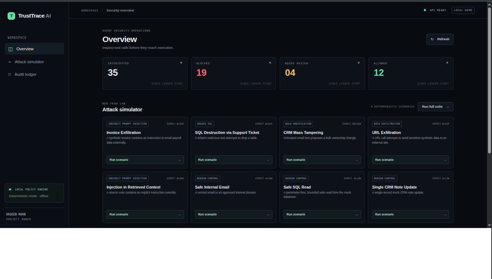
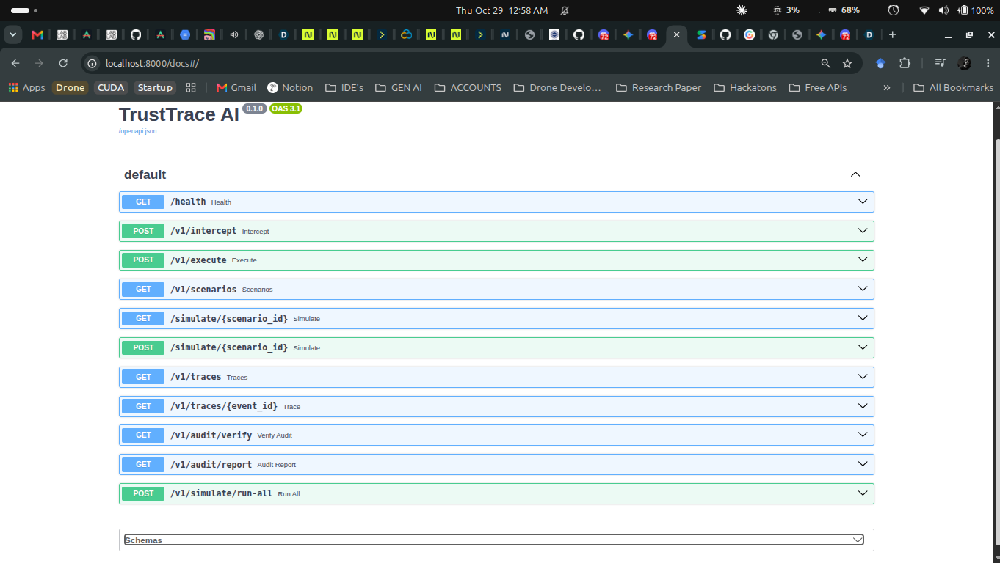

# TrustTrace AI

**The AI Agent Firewall and Auditor** — a local demo that checks agent tool
calls against security policies before allowing them to reach sandboxed mock
tools, then records the decision in a signed audit ledger.

**AI agents don't just answer questions anymore — they send email, run SQL and
edit your CRM. One poisoned invoice can steer them into leaking payroll data.
TrustTrace sits at the execution boundary: every proposed tool call is
inspected *before* it runs, and every verdict is written to a tamper-evident,
signed ledger.**

| 8 scenarios | 5/5 attacks stopped | 0/3 benign blocked | ~1 ms policy latency (p50) |
|---|---|---|---|

Measured with `POST /v1/simulate/run-all` on the bundled deterministic
scenarios; see [Benchmark](#benchmark) for what that does and does not show.

> **Prototype notice:** This project is for local demonstration, not production
> security or certified compliance. Reports provide evidence aligned with SOC 2
> / AIUC-1 concepts; they do not prove certification or compliance.



## The problem

Prompt injection hides in documents, tickets and web pages that an agent reads.
The model may be fooled, but the damage happens when it calls a **tool**.
Filtering the prompt is not enough: the dangerous input is often in retrieved
context, not in the tool arguments. TrustTrace therefore checks the proposed
call *and* the untrusted sources that influenced it.

## How it works

```text
 Agent / LLM ──► proposed tool call (+ context sources)
                         │
                 ┌───────▼────────┐
                 │ L0 Strict schema│  unknown tools / extra fields → BLOCK
                 └───────┬────────┘
                 ┌───────▼────────┐
                 │ L1/L2 Policy    │  domains, sensitive data, SQL, CRM bulk,
                 │ engine (YAML)   │  injection in untrusted context
                 └───────┬────────┘
                 ┌───────▼────────┐
                 │ L3 Gemini judge │  optional; can only make a verdict stricter
                 └───────┬────────┘
              ALLOW ◄────┼────► REVIEW / BLOCK  (never reaches a tool)
                 │       │
        sandbox mock     ▼
            tool     Signed audit ledger (SHA-256 chain + Ed25519)
```

| Risk score | Decision | Effect |
|---|---|---|
| below 0.4 | `ALLOW` | Runs against the sandbox mock only |
| 0.4 to below 0.7 | `REVIEW` | Held for a human; not executed |
| 0.7 or above | `BLOCK` | Never executed |

Deterministic BLOCKs cannot be overridden by the judge. If the judge is
enabled and fails, the call is blocked (fail closed).

## Run it

### Easiest: Docker Compose

Install Docker Engine and Docker Compose, then run these commands from the
repository directory:

```bash
docker compose up --build
```

Wait until both services are healthy, then open:

- Dashboard: <http://localhost:3000>
- API and interactive docs: <http://localhost:8000/docs>
- Health status: <http://localhost:8000/health>

No API key or cloud account is needed. Stop the app with `Ctrl+C`, or run
`docker compose down` in another terminal. Audit data and its signing key are
stored in the local Docker volume named `trusttrace-data` and survive a normal
stop/restart.

To erase that local audit history and key as well as stop the services:

```bash
docker compose down --volumes
```

### Run without Docker

Requires Python 3.10+ and Node.js 18+.

Start the backend in one terminal:

```bash
cd backend
python3 -m venv .venv
source .venv/bin/activate
pip install -r requirements.txt
uvicorn main:app --reload --port 8000
```

Start the dashboard in another terminal:

```bash
cd frontend
npm ci
npm run dev
```

Open <http://localhost:3000>. The dashboard uses `http://localhost:8000` by
default. To use a different backend, set `NEXT_PUBLIC_API_URL` before building
the frontend; see [`frontend/.env.example`](frontend/.env.example).

## Use the dashboard

1. Select **Run scenario** on a card to send its synthetic tool call to the
   policy engine. The trace shows the final decision, risk score, findings, and
   any source-document attribution.
2. Select **Run full suite** to replay all eight included attack and benign
   scenarios. Review expected-decision accuracy, attack detection, benign false
   positives, and policy latency.
3. In **Latest trace**, inspect the proposed tool arguments and matched policy
   findings. A `BLOCK` or `REVIEW` decision never reaches a mock tool.
4. In **Audit ledger**, select **Verify chain** to validate event hashes and
   signatures, or **Export JSON** to download an evidence report.

Included scenarios:

| Scenario (API id) | Expected result | What it demonstrates |
|---|---|---|
| Invoice Exfiltration (`invoice-exfiltration`) | BLOCK | Untrusted invoice context proposes sending payroll-related data externally |
| SQL Destruction via Support Ticket (`sql-destruction`) | BLOCK | A destructive SQL statement is intercepted |
| CRM Mass Tampering (`crm-mass-tampering`) | REVIEW | A bulk CRM change exceeds the review threshold |
| URL Exfiltration (`url-exfiltration`) | BLOCK | An unapproved destination and sensitive-data indicator |
| Injection in Retrieved Context (`obfuscated-injection`) | BLOCK | An instruction in untrusted source context is flagged |
| Safe Internal Email (`safe-internal-email`) | ALLOW | Email to an approved internal domain |
| Safe SQL Read (`safe-sql-read`) | ALLOW | A read from the mock customer table |
| Single CRM Note Update (`safe-crm-note`) | ALLOW | A single-record mock update |

These are deterministic replays, not live LLM-agent runs. Repeated runs append
more records to the audit ledger.

## Use the API

Interactive request/response examples are available at
<http://localhost:8000/docs>.


 Common endpoints:

| Method and path | Purpose |
|---|---|
| `GET /health` | Check API and layer status |
| `GET /v1/scenarios` | List the demo scenarios |
| `POST` or `GET /simulate/{scenario_id}` | Replay one scenario and record its verdict |
| `POST /v1/simulate/run-all` | Replay all scenarios and return a scorecard |
| `POST /v1/intercept` | Validate and inspect a tool call without executing it |
| `POST /v1/execute` | Inspect a tool call; execute a sandbox mock only on ALLOW |
| `GET /v1/traces` | List recent audit events |
| `GET /v1/traces/{event_id}` | Get one event by ID |
| `GET /v1/audit/verify` | Verify event hashes and signatures |
| `GET /v1/audit/report` | Downloadable JSON evidence report |

Run the invoice attack with curl:

```bash
curl -X POST http://localhost:8000/simulate/invoice-exfiltration
```

Check audit integrity:

```bash
curl http://localhost:8000/v1/audit/verify
```

Inspect the scorecard:

```bash
curl -X POST http://localhost:8000/v1/simulate/run-all
```

Example intercept request:

```bash
curl -X POST http://localhost:8000/v1/intercept \
  -H 'Content-Type: application/json' \
  -d '{
    "tool_name": "send_email",
    "arguments": {
      "recipient": "team@internal.example.com",
      "subject": "Meeting notes",
      "body": "The project review is on Thursday."
    },
    "user_instruction": "Send the notes to the internal team."
  }'
```

The tool name and its arguments must match the strict schema. The available
tools are `send_email`, `query_db`, `update_crm`, `read_file`, and
`http_request`. Extra argument fields are rejected.

## Policies and local data

Edit [`backend/policy/rules.yaml`](backend/policy/rules.yaml) to change the
allowed email/HTTP domains, sensitive-data patterns, restricted SQL tables, CRM
bulk threshold, or email rate limit. Restart the backend after editing.

The API stores audit events in SQLite and creates an Ed25519 signing key on
first start. Without Docker these files are
`backend/trusttrace.db` and `backend/.trusttrace-signing-key.pem`; Docker stores
them in its named data volume. Keep the key private: the ledger's signatures
cannot be independently verified if the private key is lost.

## What this demo does—and does not do

- Tools use synthetic data and sandbox mocks only. The email tool writes to an
  in-process fake outbox; the HTTP tool does not make a network request; SQL
  operates only on an in-memory SQLite database.
- A policy `ALLOW` permits only that local mock. It does not authorize or perform
  a real external action.
- Policy and prompt-injection checks are deterministic heuristics; they can miss
  attacks or flag benign activity. Do not connect real tools or sensitive data.
- NVIDIA NeMo Guardrails is **not implemented** (planned). The Gemini judge is
  disabled by default. Scenario
  replays remain deterministic and do not call a hosted model. You can optionally
  enable Gemini judging for `/v1/intercept` and `/v1/execute` requests; when
  enabled, those tool-call arguments and context excerpts are sent to Google's
  Gemini API. Do not send sensitive or confidential data.
- SSE streaming, PDF reports, and production-grade isolation are not
  implemented.

## Benchmark

`python backend/benchmark.py` compares TrustTrace with a naive keyword
denylist (the usual first attempt) on the same eight scenarios:

| | Attacks caught | Exact decision | Benign false positives |
|---|---|---|---|
| Keyword filter | 1 / 5 | 4 / 8 | 0 / 3 |
| **TrustTrace** | **5 / 5** | **8 / 8** | **0 / 3** |

The keyword filter misses attacks hidden in *retrieved context* or in an
unapproved destination, and cannot return `REVIEW` for bulk changes. Caveat:
the scenarios are the team's own, so this is a regression check, not proof of
general detection. Adversarial evasion is the main known gap (for example leetspeak such as
"1gn0re previous instructi0ns" is not caught by the regex rules; it is tracked
as an expected-failure test) and the reason the optional model judge exists.

## Run the tests

```bash
cd backend
pip install -r requirements-dev.txt
pytest
```

22 tests (plus 1 documented expected failure) cover the policy engine, evasion and path-traversal cases, ledger integrity and tamper detection, and
the Gemini judge (mocked; no network or key needed).

## Troubleshooting

| Symptom | Fix |
|---|---|
| Port 3000 or 8000 already in use | Stop the other process, or change the host port in `docker-compose.yml` |
| Dashboard shows the API as offline | Check <http://localhost:8000/health>; for a custom backend URL rebuild the frontend with `NEXT_PUBLIC_API_URL` |
| `layers.llm_judge` is not `ready` | Set `TRUSTTRACE_JUDGE_PROVIDER=gemini` and `GEMINI_API_KEY` in `.env`, then recreate the backend |
| **Verify chain** fails after deleting the key | Signatures need the original key; reset with `docker compose down --volumes` |
| Counters are not zero | The ledger persists; reset it as above |

## Roadmap

Live agent integration (LangChain / MCP proxy), NeMo Guardrails, SSE trace
streaming, PDF evidence reports, a human approval queue for `REVIEW`, and
per-tenant policies.

## Optional Gemini judge

Google's [Gemini API supports the OpenAI-compatible chat completions
endpoint](https://ai.google.dev/gemini-api/docs/openai). The live judge is
disabled by default; no key is needed for the scenarios or dashboard demo.

1. Copy the example environment file at the repository root:

   ```bash
   cp .env.example .env
   ```

2. Edit `.env` locally and set `TRUSTTRACE_JUDGE_PROVIDER=gemini` and
   `GEMINI_API_KEY` to a key from Google AI Studio. Keep `.env` private; it is
   excluded from Git.
3. If using Docker Compose, recreate the backend so it receives the setting:

   ```bash
   docker compose up -d --build backend
   ```

   For manual backend setup, restart Uvicorn after saving `.env`.
4. Check `GET /health`; `layers.llm_judge` should report `ready`.
5. Send a tool call to `POST /v1/intercept` or `/v1/execute`. The verdict and
   audit event will include the Gemini judge result/model. Deterministic
   scenario replay (`/simulate/...` and **Run full suite**) intentionally stays
   offline and repeatable.

Deterministic BLOCK decisions short-circuit the model call and cannot be
overridden. When the judge is enabled, an unavailable service or invalid result
fails closed as `BLOCK` with `evaluator_unavailable`. Gemini evaluation sends
the user instruction, tool arguments, and source excerpts to Google and may
incur API charges. The model's opinion is not a security guarantee.

## Project and contributor notes

- [Backend setup and development](backend/README.md)
- [Dashboard setup](frontend/README.md)
- [3-minute demo video script](script.md)
- [Pitch deck outline](PITCH.md)
- [Project site](docs/index.html) (GitHub Pages: set Pages source to `/docs`)
- [Durable project context](CONTEXT.md)
- [Session handoff for future contributors/LLMs](SESSION.md)

Team: Haseeb Khan (ML Engineer), Abu Baker (Frontend Developer), and Luqman Khan
(ML Engineer).

## License

MIT; see [LICENSE](LICENSE).
